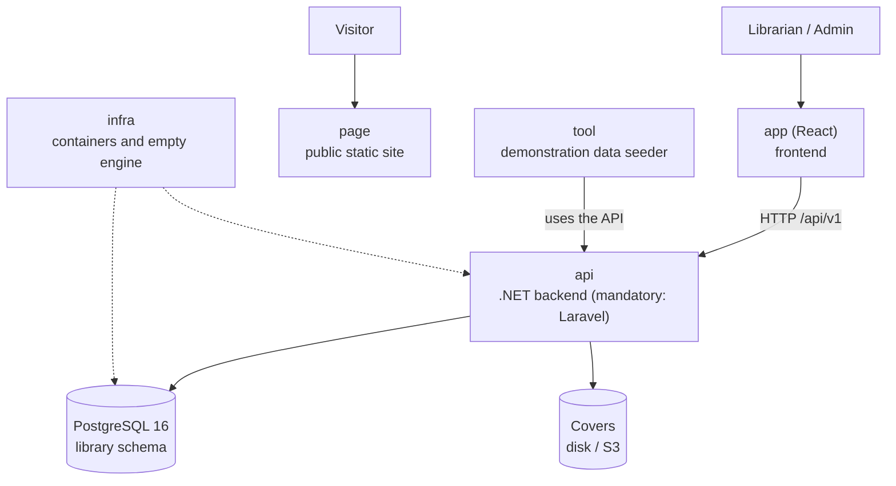

# Architecture at a Glance — Manager Library

Read this in five minutes before opening the rest. Details are in [`architecture.md`](architecture.md).
This diagram uses the .NET reference terminology; the mandatory implementation uses PHP/Laravel, React, PostgreSQL 16, and Docker Compose.

## The system in one diagram

## The six repositories and their roles

| Repo | Role | Verified by |
|---|---|---|
| `docs` | The specification | This reading is sufficient to build the system |
| `api` | Business rules and HTTP contract | Domain, application, contract, and concurrency tests |
| `app` | Operational screens | An end-to-end flow: login → lend → return → report |
| `page` | Public presentation, without calling the API | It looks correct on mobile and desktop |
| `infra` | `docker compose up` and the empty database | It starts with a single command |
| `tool` | Demonstration data (books, members, loans) | The presentation event has real data |

## The five ideas that support the design

1. **A loan is an immutable fact**; only an item's `returned_at` changes.
2. **Copies are withdrawn and restocked within the same operation** that creates or closes the item.
3. **Status is calculated**: `open`, `overdue`, and `closed` are not stored in the database.
4. **Snapshotted values do not follow the catalog**: the October report does not change because a book is renamed in November.
5. **The database is the final barrier**: if the copy `CHECK` fails, something wrote outside the system.
